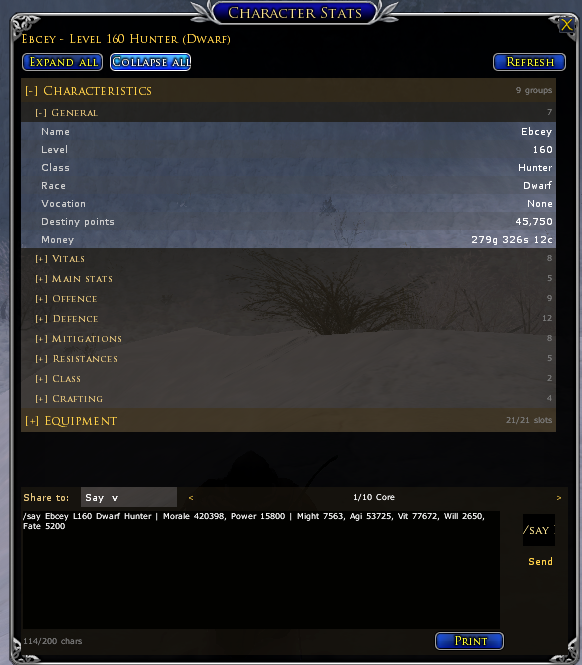
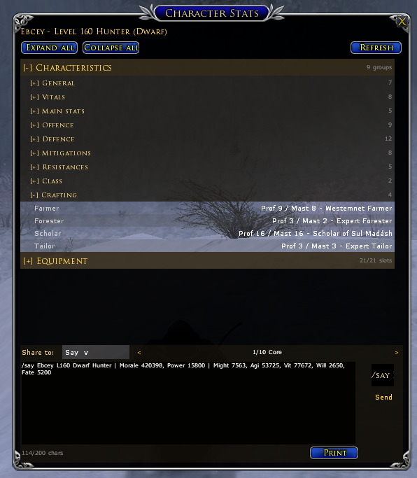
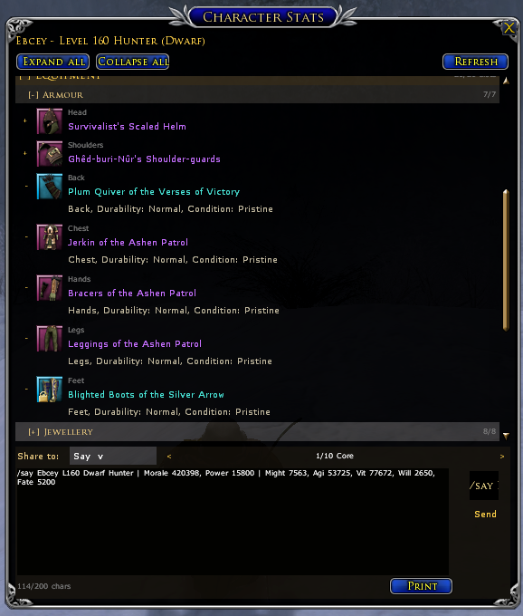
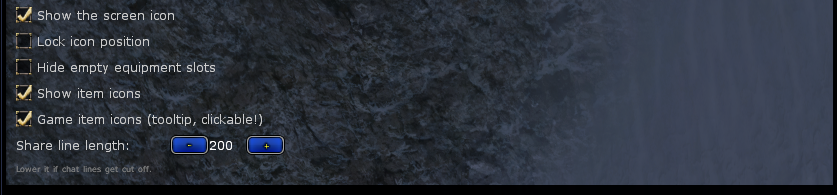

# CharacterStats

A [The Lord of the Rings Online](https://www.lotro.com) plugin that shows your
character's current stats and equipped items in one window, with collapsible
groups, and lets you share them to chat. It updates as you equip and unequip
gear or gain and lose buffs.



*The Characteristics group with General expanded, and the share panel at the bottom.*



*The Crafting group: proficiency, mastery and your title for every profession.*



*Equipped armour: item icons, names in quality colour and the item details. Click an item to show or hide its details.*



*The options in the plugin manager.*

## Features

- **Live stats in collapsible groups.** **Characteristics** has General, Vitals,
  Main stats, Offence, Defence, Mitigations, Resistances, Class and Crafting.
  **Equipment** has Armour, Jewellery and Weapons & Tools. Click any header to
  collapse or expand it, or use **Expand all** / **Collapse all**.
- **Equipped items.** Each slot shows the item icon and the item name in its
  quality colour. Below it you see the item's description, category,
  durability and condition. Click an item row to hide or show this text.
  Empty slots show as `(empty)`, and you can hide them.
- **Automatic updates.** The window refreshes when you equip or unequip
  items and when you level up. While it is open it also refreshes once per
  second, which catches buffs, regen, morale and power.
- **Screen icon.** A small **CS** icon: left-click toggles the window,
  left-drag moves the icon, right-click opens a menu with Show/Hide, Refresh,
  Expand/Collapse all, Lock icon position, Hide this icon and Options.
- **Share to chat.** Your stats are split into short chat lines (Core,
  Offence, Defence, Mitigation, Gear). You choose the channel and send one
  page at a time.
- **F12 (hide HUD)** hides the icon and the window, and pressing it again
  brings them back. If you use `/cstats` commands while the HUD is hidden,
  they still work: `/cstats show` opens the window right away, and
  `/cstats hide` or `/cstats icon hide` keep that window or icon hidden when
  the HUD comes back.
- **Saved per character.** Window position and size, icon position, collapsed
  groups and all options are saved.

## Installation

1. Download `CharacterStats.zip` from the repository's
   [Releases](https://github.com/EBCEYS/lotro/releases) page (or take the
   `plugins/CharacterStats` folder from the repository) and copy the
   `CharacterStats` folder into the game's plugin directory:

   ```
   Documents\The Lord of the Rings Online\Plugins\
   ```

   so that the files end up as:

   ```
   Documents\The Lord of the Rings Online\Plugins\CharacterStats\Main.lua
   Documents\The Lord of the Rings Online\Plugins\CharacterStats\CharacterStats.plugin
   ```

   (plus the other `.lua` files in that folder). You don't need to create or
   edit anything.

2. In game, load the plugin:

   ```
   /plugins load CharacterStats
   ```

## Usage

- **Icon:** left-click opens or closes the stats window, left-drag moves the
  icon (unless it is locked), and right-click opens the menu.
- **Group headers** (`[-] Offence` / `[+] Offence`): click to collapse or
  expand. The number on the right is the row count (or filled/total slots for
  equipment).
- **Item rows:** descriptions are shown by default. Click an item row
  (the icon too) to hide or show its description. The plugin remembers this
  per equipment slot. **Expand all** / **Collapse all** also open or close
  every item description.
- **Crafting** (collapsed by default) has one row per profession you know:
  proficiency level, mastery level and your proficiency title, e.g.
  `Farmer   Prof 9 / Mast 8 - Westemnet Farmer`.
- Stat rows always stay on one line. If a value doesn't fit the window
  width, its end is cut off with `...`. Make the window wider to see all
  of it.
- **Refresh** re-reads everything at once.
- The window can be resized from its bottom-right corner. The list and the
  share panel adjust to the new size. In a taller window the share preview
  also gets taller.

## Sharing to chat

Plugins **cannot post to chat by themselves**. The only way is a quickslot
holding a chat command that **you click**. The slot captioned **Send** at the
bottom right of the window holds exactly the line shown in the preview next
to it. The
preview wraps and has a scroll bar, so you can always read the whole line.
Below it you see the length of the line and the limit (`143/200 chars`).
For example:

```
/say Aragorn L150 Man Hunter | Morale 98765, Power 12345 | Might 1234, Agi 23456, ...
```

- **Share to:** click the channel button to choose Say, Fellowship, Raid,
  Kinship, Officer, LFF, World or User 1–4. On a French client the French
  commands are used (`/parler`, `/monde`, ...).
- **`<` / `>`** switch between pages: Core, Offence, Defence, Mitigation and
  Gear (gear is split over several pages if needed). Click the **Send** slot
  once per page. Crafting is not included in the share pages.
- **Print** writes all pages to *your own* chat window only, so you can review
  them before you send anything.
- **Line length:** each page, including the channel command, is limited to
  200 characters by default (adjustable from 80 to 400). The real LOTRO chat
  limit is not documented. If your lines get cut off, lower it with
  `/cstats maxlen 150` or in the options.
- Some channels may throttle messages sent quickly one after another. If that
  happens, wait a moment between pages.

## Commands

| Command | Description |
| --- | --- |
| `/cstats` or `/cstats toggle` | Show or hide the stats window |
| `/cstats show` / `/cstats hide` | Show / hide the stats window |
| `/cstats refresh` | Re-read all stats |
| `/cstats icon` | Toggle the screen icon (`icon show` / `icon hide` also work) |
| `/cstats expand` / `/cstats collapse` | Expand / collapse all groups |
| `/cstats share` | List the share channels |
| `/cstats share <channel>` | Choose the share channel (`say`, `fellow`, `raid`, `kin`, `officer`, `lff`, `world`, `user1`–`user4`) |
| `/cstats maxlen <80-400>` | Maximum length of a shared chat line |
| `/cstats print` | Print all share pages to your own chat window |
| `/cstats reset` | Reset window/icon positions and the window size |
| `/cstats options` | Open the plugin options in the plugin manager |
| `/cstats help` | Command overview |

`/characterstats` is a full alias for `/cstats`.

## Settings

Open the plugin manager, select **CharacterStats** and press **Options** (or
type `/cstats options`, or use the icon menu). Changes apply immediately and
are saved per character.

| Setting | Default | Meaning |
| --- | --- | --- |
| Show the screen icon | on | Show the small **CS** icon |
| Lock icon position | off | Turn off dragging (clicking still toggles the window) |
| Hide empty equipment slots | off | Leave empty slots out of the Equipment group |
| Show item icons | on | Show an icon for each equipped item. It is only a picture: clicking it just shows or hides the description |
| Game item icons (tooltip, clickable!) | off | Use the game's own item control instead. It shows the native tooltip with the item's stats, but it is fully interactive (see Limitations) |
| Share line length | `200` | Maximum characters per shared chat line, 80–400 in steps of 20 |

The plugin also saves the window position, size and visibility, the icon
position, the collapsed groups, the share channel and the current share page.

## Limitations

- Stat values are the raw numbers the game API returns. Most are **ratings**,
  not the percentages shown in the character panel.
- The API gives no item stats, only name, description, quality, category,
  durability and condition. To see item stats, turn on **Game item icons**
  and hover the icon for the game's tooltip.
- Some items have no description in the game's text tables. The game then
  returns a "string table error" placeholder, which the plugin hides: such an
  item shows only its category, durability and condition line (and an item
  name that is missing this way shows as "(unnamed item)").
- Many stat getters (offence, defence, mitigations, regen, finesse, healing)
  are **undocumented** and exist only in the game client. The plugin checks
  for each one first, and any stat the client doesn't provide is left out.
- With **Game item icons** on, the icon is a real game item control. The
  game documents it as fully interactive, so clicking it may use the item
  (pocket items, class items, ...), and dragging it may move it. That is why
  this option is off by default.
- F12 tracking starts from "HUD visible". If you load the plugin while the HUD
  is hidden, press F12 twice to get back in sync. The API can't report the HUD
  state.
- Channel commands are English, with French overrides. Other languages are
  untested.
- Monster Play characters get a short list (the API gives very few stats
  for them).

## Author & license

**Ebceys**, version 1.0.0.

Released under the [Beer-ware License](../LICENSE).
