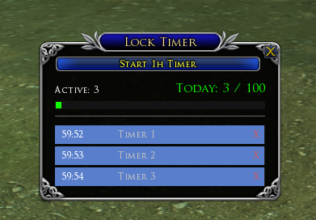
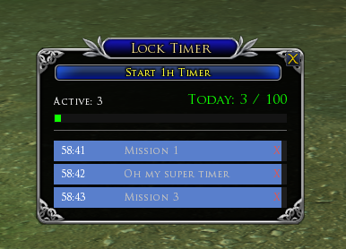

# InstanceLockTimer

A [The Lord of the Rings Online](https://www.lotro.com) plugin that tracks your
instance lock cooldowns: start a one-hour timer with a single click and keep an
eye on how many you have used today.



*The main window with three active one-hour timers running.*



*The same three timers after renaming them — click a timer's name to edit it.*

## Features

- **One-click 1h timer** — the big button starts a standard one-hour instance
  lock timer.
- **Active counter** — shows how many timers are running and decreases
  automatically whenever a timer expires.
- **Per-day usage counter** — "Today: N / 100" counts how many timers you
  started during the current server day, drawn in a gradient colour from green
  (0) to red (100) with a matching progress bar.
- **Server day reset** — the daily counter resets at the server day change
  (07:00 UTC). Active timers are *not* reset; they keep counting down until
  they expire.
- **Rename timers** — click a timer's name to rename it: press Enter (or click
  anywhere else) to confirm, Escape to cancel.
- **Cancel early** — the "X" on a row removes that timer; if you started it
  during the current server day, the daily counter gets that start back
  (it never goes below 0).
- **Survives logout** — timers are stored per character with absolute expiry
  times, so they keep running through logout, `/ui reload` and relogging. If
  the server day changed while you were offline, the daily counter resets on
  load.

## Installation

1. Create the plugin folder:

   ```
   Documents\The Lord of the Rings Online\Plugins\InstanceLockTimer\
   ```

2. Copy `Main.lua` and `InstanceLockTimer.plugin` into that folder.

   The `.plugin` file is a plain text file with this content:

   ```xml
   <?xml version="1.0" encoding="utf-8"?>
   <Plugin>
     <Information>
       <Name>InstanceLockTimer</Name>
       <Author>Ebceys</Author>
       <Version>1.0</Version>
       <Description>One-hour instance lock timers with per-day usage counter.</Description>
     </Information>
     <Package>InstanceLockTimer.Main</Package>
     <Configuration Apartment="InstanceLockTimer" />
   </Plugin>
   ```

   > If you install under an author folder instead, e.g.
   > `Plugins\Ebceys\InstanceLockTimer\`, change the entry point to
   > `<Package>Ebceys.InstanceLockTimer.Main</Package>`.

3. In game, load the plugin:

   ```
   /plugins load InstanceLockTimer
   ```

   (You can also enable it once in the plugin manager and save it in your
   character's UI settings.)

## Commands

| Command | Description |
| --- | --- |
| `/ilt show` | Show the main window |
| `/ilt add <minutes>` | Start a custom-length timer (e.g. `/ilt add 1` for a quick test) |
| `/ilt resetdaily` | Reset the daily counter |
| `/ilt help` | Command overview |

`/InstanceLockTimer` works as a full alias for `/ilt`.

## How it works

- Timer state is saved per character via the game's PluginData storage:
  each timer stores its absolute expiry time (server time), so nothing has to
  keep running while you are logged out.
- The daily counter belongs to the *server day*, which changes at 07:00 UTC.
- Timer names and the window position are saved alongside the timers.

## Tuning

The tweakable values are in the `CONFIGURATION` section at the top of
`Main.lua`:

| Constant | Default | Meaning |
| --- | --- | --- |
| `TIMER_DURATION` | `3600` | Length of a standard timer, seconds |
| `DAY_RESET_UTC_HOUR` | `7` | UTC hour at which the daily counter resets |
| `DAILY_MAX` | `100` | Daily gradient: green at 0, red at `DAILY_MAX` |
| `MAX_VISIBLE_ROWS` | `8` | Timer rows shown before a "+N more" line appears |

## Author

**Ebceys** — version 1.0.