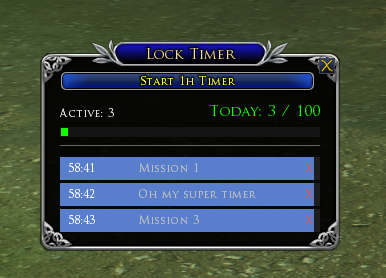

# InstanceLockTimer

A [The Lord of the Rings Online](https://www.lotro.com) plugin that tracks your
instance lock cooldowns: start a one-hour timer with a single click and keep an
eye on how many you have used today.


*The main window with three active one-hour timers running.*



*The same three timers after renaming them — click a timer's name to edit it.*


*The plugin will offer you to start timer on mission acception.*

## Features

- **One-click 1h timer** — the big button starts a standard one-hour instance
  lock timer.
- **Active counter** — shows how many timers are running and decreases
  automatically whenever a timer expires.
- **Per-day usage counter** — "Today: N / 100" counts how many timers you
  started during the current server day, drawn in a gradient colour from green
  (0) to red (100) with a matching progress bar.
- **Server day reset** — the daily counter resets at the server day change
  (by default 07:00 UTC in summer, 08:00 UTC in winter; configurable). Active
  timers are *not* reset; they keep counting down until they expire.
- **Rename timers** — click a timer's name to rename it: press Enter (or click
  anywhere else) to confirm, Escape to cancel.
- **Cancel early** — the "X" on a row removes that timer; if you started it
  during the current server day, the daily counter gets that start back
  (it never goes below 0).
- **Mission offers** — the moment you accept a mission, the game writes
  "New Quest: Mission: *\<name\>*" to chat and the plugin opens a small
  offer window: one click starts a 1h timer named after that mission.
  The warp announcement ("New Quest: *\<name\>*" without the "Mission:"
  prefix) is deliberately ignored, so the offer appears only on
  accepting. English client text only.
- **Survives logout** — timers are stored per character with absolute expiry
  times, so they keep running through logout, `/ui reload` and relogging. If
  the server day changed while you were offline, the daily counter resets on
  load.

## Installation

1. Copy the `InstanceLockTimer` folder (containing `Main.lua` and
   `InstanceLockTimer.plugin`) into the game's plugin directory:

   ```
   Documents\The Lord of the Rings Online\Plugins\
   ```

   so that the files end up as:

   ```
   Documents\The Lord of the Rings Online\Plugins\InstanceLockTimer\Main.lua
   Documents\The Lord of the Rings Online\Plugins\InstanceLockTimer\InstanceLockTimer.plugin
   ```

   Nothing needs to be created, changed or edited.

2. In game, load the plugin:

   ```
   /plugins load InstanceLockTimer
   ```

   (You can also enable it once in the plugin manager and save it in your
   character's UI settings.)

## Commands

| Command | Description |
| --- | --- |
| `/ilt show` | Show the main window |
| `/ilt options` | Open the plugin settings in the plugin manager |
| `/ilt add <minutes>` | Start a custom-length timer (e.g. `/ilt add 1` for a quick test) |
| `/ilt resetdaily` | Reset the daily counter |
| `/ilt help` | Command overview |

`/InstanceLockTimer` works as a full alias for `/ilt`.

## How it works

- Timer state is saved per character via the game's PluginData storage:
  each timer stores its absolute expiry time (server time), so nothing has to
  keep running while you are logged out.
- The daily counter belongs to the *server day*, which changes at the
  configured reset time (07:00 UTC in summer, 08:00 UTC in winter by default).
- Timer names and the window position are saved alongside the timers.

## Settings

Open the plugin manager, select **InstanceLockTimer** and press **Options**
(or type `/ilt options`). Changes apply immediately and are saved
account-wide.

| Setting | Default | Meaning |
| --- | --- | --- |
| Reset time (UTC, summer) | `07:00` | Server day change in summer time (hour and minutes, 5-minute steps) |
| Winter time | on | In winter the daily reset happens one hour later |
| Detect winter time automatically | on | Switch winter/summer time on the US daylight saving dates (2nd Sunday of March / 1st Sunday of November) |
| Offer mission timers | on | Watch chat for accepted missions and offer a named timer |
| Width | `300` | Main window width, 240–600 px |
| Visible timer rows | `8` | Timer rows shown before a "+N more" line appears (1–20); the height follows the number of timers |

The panel also shows when the next daily reset happens. Changing the reset
settings does not reset today's counter.

## Tuning

A few remaining constants are in the `CONFIGURATION` section at the top of
`Main.lua`:

| Constant | Default | Meaning |
| --- | --- | --- |
| `TIMER_DURATION` | `3600` | Length of a standard timer, seconds |
| `DAILY_MAX` | `100` | Daily gradient: green at 0, red at `DAILY_MAX` |

## Author & license

**Ebceys** — version 1.3.

Released under the MIT License.