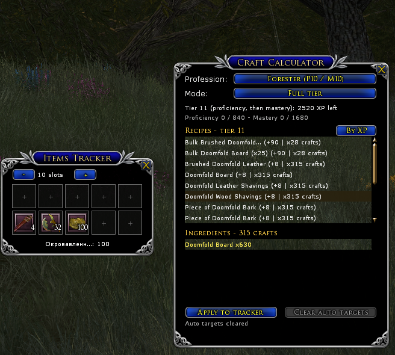
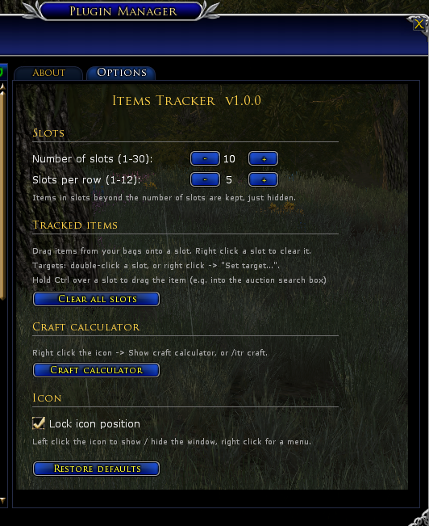
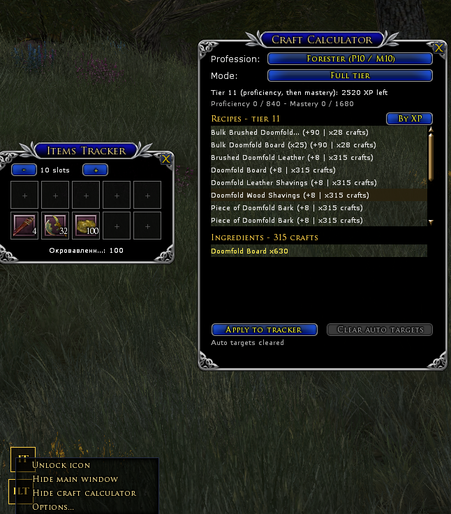
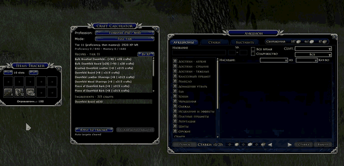
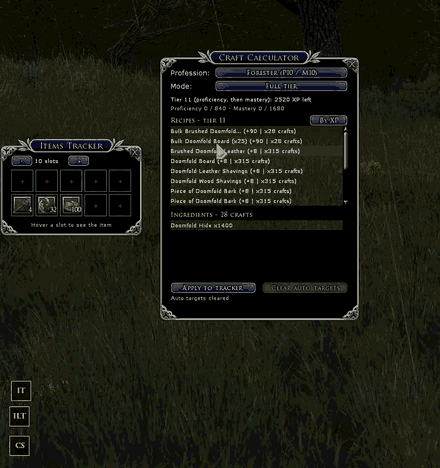

# ItemsTracker

A [The Lord of the Rings Online](https://www.lotro.com) plugin that shows how
many of the items you choose are in your bags: drag an item onto a slot and
watch its count update live. Set a target count to see your collecting
progress go from red to green, Ctrl+drag a tracked item straight into
the auction house search box — and a craft calculator that turns the
ingredients for your next profession tier into those targets.



*The Craft Calculator with a selected Forester recipe, and the tracker window with live counts. The highlighted ingredient is ready to be applied to a tracker slot.*



*The options in the plugin manager: slots, tracked items, the craft calculator and the icon.*



*The "IT" screen icon with its right-click menu: icon lock, main window, craft calculator and options.*

## Features

- **Item slots**: a small window with slots (6 by default; 1–30, in rows of
  1–12). Empty slots show a "+". The **–** / **+** buttons at the top left
  of the window remove or add a slot; the window grows and shrinks with it,
  while the buttons stay in place, so you can click them several times.
- **Drag & drop**: drag any item from your bags onto a slot to track it. The
  slot shows the item's icon and how many of it you carry. All stacks are
  added up.
- **Live counts**: the count updates right away when items are added to,
  removed from or moved in your bags. A stack that grows or shrinks in place
  (looting into an existing stack, using one potion) is picked up within
  about 2 seconds.
- **Used up items stay**: when you have none left, the slot keeps the item
  and shows a red **0** with a darkened icon, so you see what to restock.
- **Target count**: give a slot the number of items you want to collect
  (**double-click** the slot, or right click → **Set target...**, or
  `/itr target`). The count then changes colour from **red** (none yet)
  over **yellow** (half) to **green** (target reached), and a thin bar
  along the bottom of the slot shows the progress.
- **Craft calculator**: a second window (icon menu or `/itr craft`) that
  picks up where the targets end: choose a profession, a mode and a recipe
  of the next tier, and it shows the crafts needed for the XP you are
  missing and the ingredients for them. **Apply to tracker** starts a pick
  mode in which you click the empty slots of the main window that the
  ingredients should go to (see [Craft calculator](#craft-calculator)
  below).
- **Name line**: hover a slot to see the item name (in its quality colour)
  and the full count under the slots. Left click a slot to keep it shown
  there. Large counts are shortened in the slot ("12k", "3M"). In a narrow
  window the line gets shorter ("Rope: 10 / 20" instead of "Rope: 10 / 20
  in bags", then a shortened name).
- **Ctrl+drag**: hold **Ctrl** over a tracked slot and the real item from
  your bags appears over the slot's icon. Drag it like an item from your
  bags, for example into the **auction house search box**. The slot keeps
  tracking the item; nothing changes in the plugin.
- **Replace and move**: dropping an item on a filled slot replaces it.
  Dropping an item that is already tracked in another slot moves it there.
- **Per character**: the tracked items are saved per character, together
  with the window and icon positions and whether the window is shown.
- **Screen icon**: a small gold-framed "IT" icon gives quick access to the
  window (see below).

## Icon

The plugin puts a small "IT" icon on the screen. The first time, it is
placed next to the main window: to the left of it, or to the right, above or
below it if there is no room on that side. After that it stays where you
drag it.

- **Left click**: shows the main window when it is hidden, hides it when it
  is shown.
- **Left drag**: moves the icon (unless it is locked). Dragging a locked
  icon does nothing; it doesn't count as a click.
- **Right click**: opens a menu:
  1. **Lock icon / Unlock icon**: locks the icon in place so it can't be
     dragged by accident (also in the settings).
  2. **Show main window / Hide main window**.
  3. **Show craft calculator / Hide craft calculator**: opens or hides the
     craft calculator (greyed out if it is unavailable).
  4. **Options...**: opens the plugin settings.
- **HUD toggle (F12)**: hides the icon, the main window and a shown craft
  calculator together with the game's HUD, and brings them back on the next
  press. No counting happens while they are hidden. `/itr show` (or
  **Show main window**) while the HUD is hidden brings the icon and the
  windows back at once.

## Installation

1. Download the plugin's zip from the
   [Releases](https://github.com/EBCEYS/lotro/releases) page, or copy the
   `ItemsTracker` folder (containing `Main.lua`,
   `CraftingDataProvider.lua`, `CraftingWindow.lua` and
   `ItemsTracker.plugin`) into the game's plugin directory:

   ```
   Documents\The Lord of the Rings Online\Plugins\
   ```

   so that the files end up as:

   ```
   Documents\The Lord of the Rings Online\Plugins\ItemsTracker\Main.lua
   Documents\The Lord of the Rings Online\Plugins\ItemsTracker\CraftingDataProvider.lua
   Documents\The Lord of the Rings Online\Plugins\ItemsTracker\CraftingWindow.lua
   Documents\The Lord of the Rings Online\Plugins\ItemsTracker\ItemsTracker.plugin
   ```

   Nothing needs to be created, changed or edited.

2. In game, load the plugin:

   ```
   /plugins load ItemsTracker
   ```

   (You can also enable it once in the plugin manager and save it in your
   character's UI settings.)

## Usage

1. Open your bags and drag an item onto an empty slot. The item stays in
   your bags; the plugin only reads it.
2. The slot shows the total number of that item in your bags.
3. To track something else in a slot, drop the new item on it.
4. To empty a slot, right click it and choose **Clear slot** (or **Clear all
   slots**), or use `/itr clear <n>`.
5. To set how many you want to collect, **double-click** the slot, or right
   click it and choose **Set target...** (the menu entry shows the current
   target, e.g. **Set target (20)...**; a target set by the craft
   calculator shows as **Set target (20, auto)...**). A field opens under
   the slots,
   with "Target for Rope:" in front of it, and the slot gets a gold frame.
   Type the number and press **Enter**:
   - digits only; thousands separators are allowed: `1000`, `1,000`,
     `1.000`, `1 000` and `1'000` all mean 1000 (so `7.9` is read as 79).
     Values above 999999 become 999999;
   - an empty field or `0` removes the target;
   - anything else (letters, `-5`, `1e3`, `0x10`) keeps the field open with
     a red "Number?" and a hint in chat, so you can correct it;
   - **Escape** cancels;
   - clicking elsewhere, opening the field for another slot or clicking
     **–** / **+** saves a valid number and drops an invalid one (with a
     hint).

   **Clear target** in the same menu removes the target too. With a target
   the name line reads "Rope: 10 / 20 in bags". The target stays with the
   item when you drag it to another slot, and is removed when a different
   item replaces it.
6. Use **–** / **+** at the top left of the window to change the number of
   slots (the same as the setting; **–** is greyed out at 1 slot, **+** at 30).
7. Lowering the number of slots does not forget anything: items in slots
   beyond the number of slots are only hidden and come back when you raise
   the number again. A chat line tells you how many, once, when tracked
   items first become hidden.
8. To drag a tracked item somewhere else (for example into the auction
   house search box), move the mouse over its slot and **hold Ctrl**: the
   item from your bags appears over the slot's icon (the name line says
   "- Ctrl+drag" when there is room for it). Drag it away while Ctrl is
   still held; you can let go of Ctrl once the drag has started. The slot
   keeps tracking the item, with its target. Dropping it back on a slot
   works like any other drop (on its own slot nothing changes).

   > **Warning:** while Ctrl is held, the item over the slot is the game's
   > own item control, the same as in your bags. A **Ctrl+click** (left or
   > right) on it can **use** the item, and dropping it on the game world
   > (outside any window) can bring up the **destroy** prompt, as from the
   > bags. An item that is not in your bags (count 0) cannot be dragged.
   > Without Ctrl, clicking a slot never uses the item.

   The item stays shown for up to 10 seconds while you drag it outside
   the window; it disappears when you come back over the window without
   Ctrl, enter another slot, or drop it. If the drag ends inside the
   window, it disappears as soon as the mouse is over the slot without
   Ctrl (at once after leaving the slot, otherwise after a second), so it
   is never left clickable without Ctrl.

   

   *Ctrl+dragging a tracked item straight into the auction house search
   box — the slot keeps tracking it.*

9. If a drop does nothing, type `/itr debug` and drop again: every drop
   event the plugin receives (on a slot or on the window, with its
   coordinates) and any error are printed in chat, as well as the Ctrl+drag
   steps (shown / hidden, drag started). `/itr debug` again turns it off.

## Craft calculator

The craft calculator (a second window, "Craft Calculator") turns the
ingredients of a recipe into targets in the main window. Open it with
**Show craft calculator** in the icon menu, or with `/itr craft`.

At the top you pick what to craft:

- **Profession**: a button that lists your learned professions with their
  levels, e.g. **Farmer (P9 / M8)** — the same levels as in the crafting
  panel (K).
- **Mode**:
  - **Proficiency**: the XP left in the current proficiency tier of the
    chosen profession;
  - **Mastery**: the XP left in the current mastery tier;
  - **Full tier**: what is still missing for the whole tier — the rest of
    the proficiency plus its whole mastery (or, once the proficiency of
    the tier is done, just the rest of the mastery).

  The tier you are working on is the number of completed tiers plus one
  (the levels the game reports are the completed ones).
- Under the two buttons, one line names the tier and the XP still missing
  ("Tier 10 proficiency: 12345 XP left"), and a second line shows both
  progress bars ("Proficiency 1200 / 4000 - Mastery 0 / 6000").
- **Recipes**: the learned recipes of that tier that give XP, sorted by XP
  reward (**By XP**, **By name** to sort alphabetically). A row reads
  `Name (+XP | xN crafts)` — e.g. **Pipe-weed (+100 | x9 crafts)**: 9 of
  that recipe give the 900 XP you are missing. Long names are shortened.
  The list scrolls with the mouse wheel.
- **Ingredients**: select a recipe (left click) and the preview lists its
  direct ingredients with the amount needed for all the crafts, in the
  item's quality colour. Each amount shows where it stands in the main
  window: **- manual (N)** · you already set that target by hand and it is
  kept, **- auto** · it is one of the calculator's targets right now,
  **- tracked** · tracked without a target. Amounts above 999999 are noted
  and set as 999999 (the tracker's maximum). A recipe that is single-use
  or has a cooldown says so, and ingredients without a readable name are
  counted separately (they cannot be tracked by name).

**Apply to tracker** starts a **pick mode** in the main window (selecting
a recipe only fills the ingredient preview — the tracker is never touched
by a selection):

| You do in the pick mode | The pick mode does |
| --- | --- |
| press **Apply to tracker** | the calculator's old auto targets are **cleared at once** (their slots become empty and pickable; they stay cleared if you cancel), the main window is shown, empty slots get a gold border, the next ingredient is named in the name line, and the two buttons turn into **Done: N of M** / **Stop picking** |
| click an **empty** slot | the next ingredient is assigned to it (icon and target), ingredients with the same name are already merged into one entry (one slot, summed amount) |
| click an **assigned** slot again | the ingredient is taken back (it is pending again; the next click assigns it somewhere else) |
| click a slot that **already tracks an item** | rejected with a one-line hint — an assignment never merges into a tracked item, and a target set by you is never overwritten; ingredients that are already tracked somewhere are not offered at all |
| clear, re-target or re-drop a **picked** slot (`/itr clear`, **Clear slot** / **Clear all slots**, **Set target** / **Clear target**, `/itr target`, an item dropped on it) | **refused with a one-line hint** — a picked slot belongs to the pick until it is taken back (click the slot again) or the picking is stopped; the target editor also stays closed while picking. Unpicked slots stay yours: clearing, re-targeting and dropping unrelated items on them works as always |
| **Escape** (main window) or **Stop picking** | the picking is stopped and **nothing is finalized** — the targets cleared at the start stay cleared. Escape needs no window focus: the key events reach the main window while the picking is on (the same model as the F12 toggle); Escape also undoes a picked slot that was modified from outside the pick |
| **Done: N of M** (press Apply again) | the assigned slots become normal auto targets; a partial assignment is fine, only the assigned slots are finalized, and the status line reports "Assigned N of M ingredients: slots ..." |

- Fewer empty visible slots than ingredients? The status line says how
  many more slots you need — press the **+** button (or `/itr slots`) and
  click the new slots. The plugin **never raises the slot count on its
  own** any more.
- The **Done: N of M** counters follow reality: an assignment whose slot
  was emptied or replaced from outside the pick is un-assigned (the
  ingredient is pending again), and an ingredient that becomes tracked by
  hand while picking is skipped — it no longer counts in M, and the
  status line says how many were skipped. Pressing **Apply** again when
  every ingredient is already tracked by hand refuses with
  "All ingredients are tracked already" instead of clearing your auto
  targets for nothing (the calculator's own auto targets do not block).
- The targets stay **live** while you craft: gains of XP update the
  amounts of the assigned slots right away through the crafting events,
  and again at the latest 3 seconds later. The recipe of the selected
  **and** of the applied profession is watched, so browsing another
  profession does not stop it.
- When the tier is finished (no XP left, tier change, recipe gone), one
  chat line tells you and the targets are **kept** — pick the next recipe,
  or clear them. The status line at the bottom of the calculator says the
  same, and Apply/Done/Stop picking report there what they did.
- **Clear auto targets** removes the calculator's targets (the ones you
  turned into manual targets by setting them by hand or re-dropping the
  item stay, as does anything you added yourself). Selecting another
  recipe while picking stops the picking (nothing is finalized).



*Applying a recipe and picking the slots for its ingredients — the targets
then count down live while crafting.*

Everything the calculator remembers — the profession, the mode, the sort
order, the selection, the window's position and whether it is shown, and
its applied session — is stored **per character**.

## Commands

| Command | Description |
| --- | --- |
| `/itr show` | Show the main window (`/itr` alone does the same) |
| `/itr hide` | Hide the main window |
| `/itr toggle` | Show the main window if it is hidden, hide it if it is shown |
| `/itr options` | Open the plugin settings in the plugin manager |
| `/itr slots <n>` | Number of slots, 1–30 (whole numbers; other input shows the usage) |
| `/itr perrow <n>` | Slots per row, 1–12 (`/itr columns <n>` works too) |
| `/itr target <n> <count>` | Target count of slot *n*, 1–999999 (same rules as the field, as one word: `1,000` works, `1 000` doesn't); `/itr target <n> clear` (or `0`) removes it |
| `/itr clear <n>` | Clear slot *n*; `/itr clear all` clears every slot |
| `/itr list` | List the tracked items, their counts and targets ("10 / 20") in chat; calculator targets are marked "(auto)", reached targets "(done)", hidden slots "(hidden)" |
| `/itr craft show\|hide\|toggle\|clear\|debug` | The craft calculator: show / hide / toggle it; `clear` removes its auto targets (manual targets and slots are kept); `debug` prints the character's crafting data — the professions with their levels, the recipe count and index base, which tiers have XP recipes and the target tier / XP left of each mode (troubleshooting) |
| `/itr debug` | Print every drop event (slot or window, with coordinates), drop errors and the Ctrl+drag steps in chat (troubleshooting); again to turn it off |
| `/itr help` | Command overview |

`/ItemsTracker` works as a full alias for `/itr`.

## Settings

Open the plugin manager, select **ItemsTracker** and press **Options**
(or type `/itr options`). Changes apply immediately.

| Setting | Default | Meaning |
| --- | --- | --- |
| Number of slots | `6` | Visible slots, 1–30 (also the **–** / **+** buttons in the window) |
| Slots per row | `6` | Slots in one row, 1–12; the window size follows |
| Lock icon position | off | The screen icon can't be dragged (same as **Lock icon** in the icon menu) |

The panel also has a **Craft calculator** section with a hint and a
**Craft calculator** button (the same toggle as the icon menu and
`/itr craft`), plus **Clear all slots** and **Restore defaults** (settings
only; your tracked items stay).

The main window and the icon are kept on the screen when the plugin loads
(for example after a resolution change); the window also moves back onto
the screen when more slots make it grow past the screen edge. A window
taller than the screen (many slots, few per row) is moved to the top of the
screen, so its title bar and the **–** / **+** buttons stay reachable.

Targets are set per slot (double-click or right click a slot), not in the
panel; the panel has a hint for it, and one for Ctrl+drag.

The settings are stored account-wide. The tracked items with their targets, the window and icon
positions and whether the window is shown are stored per character.

The craft calculator's choices (profession, mode, sort order, selection,
window position and visibility, its applied session) are stored per
character.

## Limitations

- Only your **bags** are counted: not the vault, shared storage, equipped
  items or wallet currencies (marks, medallions, ...). An item dragged from
  the vault or your character panel is tracked, but its count is what you
  carry in your bags.
- Items are recognised **by name**: different items with the same name are
  added up. After switching the client language the names no longer match;
  drag the items in again.
- A stack that changes in place can take up to about 2 seconds to update.
- The slot shows a static icon: there is no native item tooltip, and
  clicking a slot never uses the item. Only while **Ctrl** is held the
  real item is shown over it (Ctrl+drag), with the game's tooltip and
  click behaviour.
- Ctrl+drag uses the first stack of the item found in your bags. Items
  with the same name but in another bag cell are not distinguished.
- The craft calculator works with the data the game reports, so it is an
  **estimate**: critical successes and XP bonuses are not counted, only
  the **direct** ingredients of a recipe (sub-recipes are not computed),
  optional ingredients and ingredient packs are ignored, and the amount
  per craft is the recipe's XP reward as the game reports it.
- Ingredients are matched **by name** (client language): if the game names
  a bag item differently from the ingredient, the calculator would open a
  second slot instead of updating the tracked one.
- Recipe tiers are the numbers the game reports; if a recipe list looks
  empty, `/itr craft debug` shows which tiers have XP recipes.
- The **pick mode** is not a separate window: it needs the main window
  (Apply shows it). If you hide the main window while picking, the mode
  keeps running — finish it with **Done** / **Stop picking** in the
  calculator, or **Escape**, whose key events reach the main window while
  the picking is on whether or not it has the focus (the same delivery
  model the F12 toggle relies on for the screen icon). Slot counts below
  what a recipe needs are never raised automatically — the **+** button
  is yours to press.
- Unloading (or reloading) the plugin while a pick runs keeps the picked
  slots as normal auto targets, but the applied session is over — after a
  reload the live XP updating for them is gone and the "(auto)" targets
  stay until you remove them (**Clear auto targets** or `/itr craft clear`).
- The crafting events are not yet verified in game; the calculator checks
  the progress again every 3 seconds, so updates can take up to that long
  (instant updates mean the events work).

## Author & license

**Ebceys** — version 1.0.0.

Released under the [Beer-ware License](../LICENSE).
